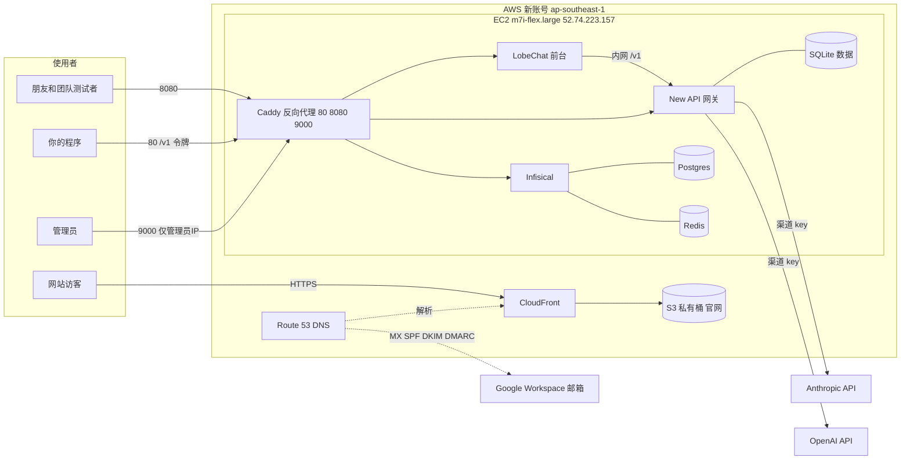
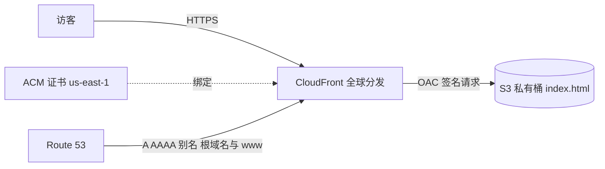

# Cakrawala Mesin Digital 系统架构文档

本文档描述当前在线运行的全部系统:AI 网关(New API)、聊天前台(LobeChat)、密钥库(Infisical)、公司官网、域名与企业邮箱。内容以 Terraform 代码和线上实际配置为准。

文档不包含任何密钥、令牌或密码。仓库应保持私有。

## 1. 系统总览

一句话:**一台 AWS 服务器**跑 AI 网关、聊天前台和密钥库;**一套静态站点**(S3 加 CloudFront)提供公司官网;**域名 DNS 统一放在 Route 53**,并指向官网和 Google Workspace 企业邮箱。

| 系统 | 作用 | 地址 |
|---|---|---|
| New API | AI 网关,统一入口、令牌与额度管理,转发到上游模型 | `http://52.74.223.157` |
| LobeChat | 对话前台,给朋友和团队测试用,有访问密码 | `http://52.74.223.157:8080` |
| Infisical | 密钥保险箱,存放上游 API Key,仅管理员 IP 可访问 | `http://52.74.223.157:9000` |
| 公司官网 | 静态网站,印尼语和英文 | `https://cakrawalamesindigital.com` |
| 企业邮箱 | Google Workspace,`info@cakrawalamesindigital.com` | Google 托管 |

## 2. 总体架构图



## 3. AI 网关与前台(EC2 上的 Docker 栈)

### 3.1 基础设施(Terraform:仓库根目录)

| 资源 | 配置 |
|---|---|
| AWS 账号 | 新账号(`pd-newapi` 本地 profile,IAM 用户 `Vivian-cakra`) |
| 区域 | `ap-southeast-1`(新加坡) |
| 实例 | `m7i-flex.large`(2 vCPU,8GB 内存),Ubuntu 24.04,20GB gp3 系统盘 |
| 弹性 IP | `52.74.223.157`(与实例分开管理,重建实例 IP 不变) |
| 密钥对 | `newapi-deploy`,公钥来自本机 `~/.ssh/id_ed25519.pub` |
| 安全组 | `newapi-sg`,规则见下表 |
| Swap | 2GB(启动脚本创建,持久生效) |

安全组规则:

| 端口 | 来源 | 用途 |
|---|---|---|
| 22 | 管理员 IP `/32` | SSH |
| 80 | 全网 | New API(经 Caddy) |
| 443 | 全网 | 预留,当前 Caddy 未启用 HTTPS |
| 8080 | 全网 | LobeChat |
| 9000 | 管理员 IP `/32` | Infisical |

管理员 IP 来自 `terraform.tfvars` 的 `allowed_ssh_cidr`。该文件在 `.gitignore` 里,不入库。

### 3.2 容器编排(服务器 `/opt/newapi/docker-compose.yml`)

由 `user_data.sh.tpl` 在实例首次启动时生成。全部容器在同一个 Docker 网络 `newapi` 内,通过服务名互访,只有 Caddy 对外发布端口。

| 容器 | 镜像 | 内部端口 | 说明 |
|---|---|---|---|
| `caddy` | `caddy:2-alpine` | 80 8080 9000 | 反向代理,路由见 3.3 |
| `new-api` | `calciumion/new-api:latest` | 3000 | AI 网关,数据为 SQLite,挂载到 `/opt/newapi/data` |
| `lobe-chat` | `lobehub/lobe-chat:latest` | 3210 | 聊天前台,配置来自 `.env` |
| `infisical` | `infisical/infisical:latest` | 8080 | 密钥库 |
| `infisical-db` | `postgres:14-alpine` | 5432 | Infisical 数据库,卷 `infisical_pg_data` |
| `infisical-redis` | `redis:7-alpine` | 6379 | Infisical 缓存,卷 `infisical_redis_data` |

### 3.3 Caddy 路由(`/opt/newapi/Caddyfile`)

| 监听 | 转发到 |
|---|---|
| `:80` | `new-api:3000` |
| `:8080` | `lobe-chat:3210` |
| `:9000` | `infisical:8080` |

当前没有域名,Caddy 以纯 HTTP 运行。给 `variables.tf` 的 `domain_name` 填值后,模板会改用该域名并让 Caddy 自动申请 HTTPS。

### 3.4 请求流程

**程序调用 API:**

1. 程序把请求发到 `http://52.74.223.157/v1/...`,带 New API 签发的令牌(`sk-...`)
2. New API 校验令牌、分组和额度
3. 按请求里的模型名,选择对应渠道(分组 `default`)
4. 使用渠道里保存的上游 key,请求上游(Anthropic 或 OpenAI)
5. 返回结果,并在 New API 里记录用量

**对话前台:**

1. 用户打开 `:8080`,输入访问密码(`ACCESS_CODE`)
2. LobeChat 用 `.env` 里保存的 New API 令牌,通过内网 `http://new-api:3000/v1` 调用网关
3. 可选模型由 `OPENAI_MODEL_LIST` 白名单决定,默认模型由 `DEFAULT_AGENT_CONFIG` 决定

### 3.5 上游渠道

| 渠道 | 说明 |
|---|---|
| Anthropic | 官方地址 `https://api.anthropic.com` 用 `sk-ant-...` key;此前曾配置过第三方中转站,存在内容经第三方、模型真伪无法确认的风险,应使用官方 key |
| OpenAI | 官方 API 平台 key(platform.openai.com),与 ChatGPT 订阅无关 |

New API 里渠道列表的"余额"列对这两家都显示 0,这是因为上游不提供查询接口,不影响使用。真实余额在各自平台的 Billing 页面查看。

## 4. 密钥与敏感信息放在哪里

| 信息 | 位置 | 说明 |
|---|---|---|
| 上游 API Key(OpenAI、Anthropic) | Infisical(保管)和 New API 渠道(实际使用) | 渠道里保存后只显示掩码,无法再看全值 |
| New API 管理员账号 | New API 数据库(SQLite) | 初始化向导里设置 |
| New API 令牌(给 LobeChat 用) | 服务器 `/opt/newapi/.env`,权限 600 | 通过 `set-lobechat-key.sh` 隐藏输入写入 |
| LobeChat 访问密码 | 同上 `.env` | 同上 |
| Infisical 加密密钥、数据库密码、认证密钥 | 同上 `.env`,由启动脚本用 `openssl` 随机生成 | **ENCRYPTION_KEY 必须备份,丢失后无法解密库里的内容** |
| AWS 访问密钥 | 本机 `~/.aws/credentials` 的 `pd-newapi` profile | 不入库 |
| Terraform 状态 | 本机 `terraform.tfstate` | 不入库,见第 9 节风险 |

当前**没有实现** Infisical 到 New API 的自动同步。方案(调用 New API 的 `PUT /api/channel/`,使用个人访问令牌)已确认可行,但尚未开发。现在换 key 需要在 Infisical 更新后,手动复制到 New API 渠道里。

## 5. 公司官网

### 5.1 架构



| 组件 | 配置 |
|---|---|
| 页面源码 | `website/index.html`,单文件,无外部依赖,印尼语和英文切换 |
| S3 桶 | `cakrawalamesindigital-com-site-<账号ID>`,**全部禁止公开访问**,只允许 CloudFront 读取 |
| CloudFront | 分发 ID `ETNDWDMH5HGZT`,价格等级 `PriceClass_200`(含亚洲),HTTP/2 与 HTTP/3,IPv6 开启,强制跳转 HTTPS,启用 AWS 托管的安全响应头策略 |
| 访问控制 | Origin Access Control,S3 桶策略只信任该分发的 ARN |
| 证书 | ACM 免费证书,覆盖根域名和 `www`,DNS 验证,自动续期 |
| 缓存 | 页面 `max-age=300`,发布后用 CloudFront 失效刷新 |

页面内容分区:首屏、服务、应用示例、游戏行业 AI、通用与定制对比、工作流程、小游戏区(记忆配对、贪吃蛇)、关于、联系。

### 5.2 Terraform(`website-infra/`)

与主栈**状态文件分开**,互不影响。包含 Route 53 托管区、ACM 证书及验证记录、S3 桶及策略、CloudFront、DNS 别名记录和 `email.tf`(邮件相关记录)。

## 6. 域名、DNS 与企业邮箱

| 项目 | 说明 |
|---|---|
| 注册商 | GoDaddy,域名 `cakrawalamesindigital.com` |
| 权威 DNS | Route 53 托管区,GoDaddy 的 Name Server 已改为 Route 53 的四条 |
| 网站记录 | 根域名和 `www` 的 A、AAAA 别名,指向 CloudFront |

企业邮箱使用 Google Workspace,DNS 记录均由 `website-infra/email.tf` 管理:

| 记录 | 值的含义 |
|---|---|
| MX(根域名) | `1 smtp.google.com` |
| TXT(根域名) | Google 域名验证;SPF `v=spf1 include:_spf.google.com ~all` |
| TXT `google._domainkey` | DKIM 公钥(超过 255 字符,拆成两段) |
| TXT `_dmarc` | `v=DMARC1; p=none;`,仅监控,不拦截 |

Google 管理控制台显示 Gmail 就绪、DKIM 已启用。管理员账号是 `info@cakrawalamesindigital.com`,同时也是网站上公开的联系邮箱。

## 7. 代码与仓库结构

```
token/
  main.tf, variables.tf, outputs.tf   主栈:EC2、EIP、安全组、密钥对
  user_data.sh.tpl                    实例首次启动脚本(Docker、Compose、Caddy、swap、随机密钥)
  terraform.tfvars                    管理员 IP 等(已 gitignore)
  old-account-state/                  旧账号的 Terraform 状态备份(已 gitignore)
  website/index.html                  官网源码
  website-infra/                      官网与 DNS、邮件的 Terraform(独立状态)
  ARCHITECTURE.md                     本文档
```

注意:仓库远端 `Vivian0826/token`(私有)里目前**没有**`website/`、`website-infra/` 和本次对 `main.tf`、`variables.tf`、`user_data.sh.tpl` 的修改,这些尚未提交。

`main.tf` 里实例设置了 `lifecycle { ignore_changes = [ami, user_data] }`,避免 Ubuntu 镜像更新或启动脚本变化触发整台重建(重建会丢服务器上的数据)。

## 8. 日常操作手册

**发布网站改动**(只上传页面,不碰其他资源):

```bash
cd website-infra
terraform apply -target=aws_s3_object.index
aws cloudfront create-invalidation --profile pd-newapi \
  --distribution-id ETNDWDMH5HGZT --paths "/*"
```

不加 `-target` 的 `apply` 会把所有变更一起应用,包括 DNS。

**更新管理员 IP**(换了网络后打不开 SSH 或 Infisical):修改 `terraform.tfvars` 的 `allowed_ssh_cidr`,在仓库根目录执行 `terraform apply`。

**更新 LobeChat 的令牌或访问密码**:

```bash
ssh -t ubuntu@52.74.223.157 /opt/newapi/set-lobechat-key.sh
```

输入时不回显。该脚本不会改动模型白名单。

**给 LobeChat 增加模型**:SSH 登录后编辑 `/opt/newapi/.env` 里的 `OPENAI_MODEL_LIST`(格式 `-all,+模型A,+模型B`),然后在 `/opt/newapi` 执行 `sudo docker compose up -d --force-recreate lobe-chat`。模型名必须和 New API 渠道里的一致。

**查看容器状态**:`cd /opt/newapi && sudo docker compose ps`,日志用 `sudo docker compose logs <服务名> --tail 50`。

**修改 DNS 或邮件记录**:改 `website-infra/` 里对应的 `.tf` 文件,用 `-target` 指定记录执行。

## 9. 已知风险与待办

按优先级:

1. **网关全程明文 HTTP。** 管理后台密码、令牌都在公网明文传输。建议给 New API、LobeChat 和 Infisical 配子域名加 HTTPS(例如 `api.`、`chat.`、`vault.` 开头的子域名),域名和 DNS 已就绪。
2. **没有备份。** New API 的 SQLite、Infisical 的 Postgres 都只在这一台服务器的系统盘上,没有快照或导出。丢盘即丢数据,包括 Infisical 的 `ENCRYPTION_KEY`。建议开启 EBS 定期快照,并离线备份 `.env`。
3. **对话记录里暴露过的凭证应轮换。** 此前有若干凭证出现在聊天记录或终端输出中:新账号 IAM 用户的访问密钥、New API 令牌、LobeChat 访问密码、一个 OpenRouter key。建议全部轮换。
4. **旧 AWS 账号**(`623717663776`)上还有一台 `t3.small` 在运行(`54.179.238.216`),状态文件在 `old-account-state/`。该账号的 IAM 用户 `Vivian` 有管理员权限,且有一把使用超过三年的访问密钥并开着控制台登录而无 MFA。不再使用的话应销毁资源并停用该密钥。
5. **IAM 权限偏大。** 部署用的 IAM 用户建议改成只含 EC2 等必要权限的策略,根账号不用于日常操作。
6. **管理员邮箱公开。** `info@` 既是 Workspace 管理员又是网站公开邮箱。建议加一个别名(如 `hello@`)对外,管理员地址不公开,并确认已开启两步验证。
7. **Terraform 状态只在本机。** 两个栈的状态文件都在这台电脑上。建议迁到带锁和版本的远端后端(S3 加锁表),并确保本机备份。
8. **镜像用 `latest` 标签。** 重新拉取可能引入不兼容变化。建议固定版本号。
9. **系统盘使用约 54%**(9.9GB / 19GB)。Docker 镜像和日志会继续增长,应监控磁盘,必要时扩容。
10. **Infisical 到 New API 的自动同步未开发**,见第 4 节。
11. **没有监控与告警。** 此前发生过一次内存耗尽导致服务器无响应(`t3.small` 时),换成 `m7i-flex.large` 并加 swap 后解决。建议配置实例状态检查告警。

## 10. 合规与使用边界

* New API 是 AGPL 许可的开源软件,二次开发后对外提供服务需公开修改后的源码。
* 向境内用户提供生成式 AI 服务涉及备案等监管要求。当前仅为小范围测试,面向公众运营之前需先完成相关手续。
* ChatGPT Plus、Claude Pro 这类个人订阅不能当 API 使用。把订阅转成 API 转发给他人违反服务条款,本系统不采用。上游一律使用官方 API 平台的 key。
* 使用第三方中转站意味着对话内容和 key 经过第三方,应避免传输敏感信息。

## 11. 成本构成(定性)

| 项目 | 说明 |
|---|---|
| EC2 `m7i-flex.large` | 主要成本,按小时计费 |
| 20GB gp3 系统盘 | 很小 |
| 弹性 IP | 绑定在运行中的实例上时通常不额外收费 |
| Route 53 托管区 | 约每月 0.5 美元 |
| S3、CloudFront、ACM | 官网流量很小,近似零头;证书免费 |
| 域名 | GoDaddy 按年,注意续费价通常高于首年促销价 |
| Google Workspace | 按用户按月 |
| 上游模型调用 | 按用量,在 OpenAI、Anthropic 平台计费,与 New API 里的虚拟额度不是同一套数字 |

具体金额以各平台账单为准。
